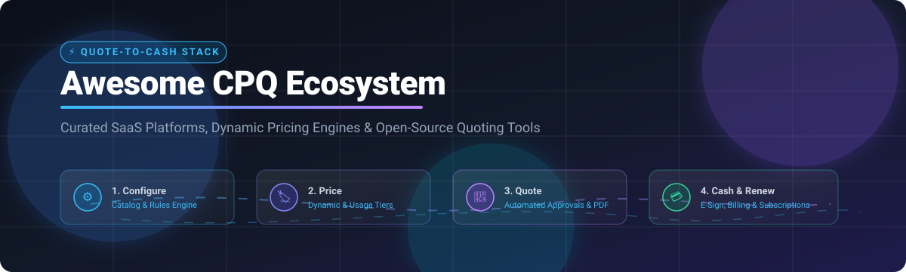

# ⚡ Awesome Configure, Price, Quote (CPQ)

<p align="center">
  
</p>

<p align="center">
  <a href="https://github.com/ishandutta2007/Awesome-Awesome-Awesome"></a><a href="https://discord.gg/jc4xtF58Ve"></a>
  <a href="https://github.com/ishandutta2007/Awesome-Configure--Price--Quote-Cpq/stargazers"></a>
  <a href="https://github.com/ishandutta2007/Awesome-Configure--Price--Quote-Cpq/network/members"></a>
  <a href="https://github.com/ishandutta2007/Awesome-Configure--Price--Quote-Cpq/blob/main/LICENSE"></a>
  <a href="https://github.com/ishandutta2007"></a>
</p>

> 🎯 **A curated list of awesome Configure, Price, Quote (CPQ) software, dynamic pricing engines, quote-to-cash (QTC) platforms, and open-source quoting automation tools.**

---

## 📑 Table of Contents
- [🌐 Sector Overview & Market Dynamics](#-sector-overview--market-dynamics)
- [💼 SaaS & Hosted CPQ Platforms](#-saas--hosted-cpq-platforms)
- [🔓 Open-Source GitHub Projects](#-open-source-github-projects)
- [🏗️ Recommended Architecture Stacks](#-recommended-architecture-stacks)
- [🤝 How to Contribute](#-how-to-contribute)
- [📈 Star History](#-star-history)
- [⚖️ Disclaimer](#-disclaimer)

---

## 🌐 Sector Overview & Market Dynamics

The global **Configure, Price, Quote (CPQ)** software market is valued at approximately **$3.6B to $3.9B in 2026** (projected to reach over **$5.8B by 2028** at a **CAGR of ~16–18%**). The sector is **moderately concentrated**—dominated at the top end by mega-cap enterprise CRM/ERP suites (Salesforce, Oracle, SAP), yet balanced by specialized, high-growth mid-market and manufacturing solutions (DealHub, Conga, Tacton, PandaDoc) that thrive where vertical-specific product rules, visual 3D configuration, or agile usage-based billing prevent a single winner-take-all monopoly.

---

## 💼 SaaS & Hosted CPQ Platforms

*Enterprise and high-growth commercial CPQ & Quote-to-Revenue platforms, sorted by corporate valuation / revenue (descending).*

| 🏢 Platform | 💰 Company Valuation / Revenue | 🏷️ Pricing (Starting Tier) | 🎁 Free Tier / Trial Limits | 🔍 Key CPQ Capabilities |
| :--- | :--- | :--- | :--- | :--- |
| **[Oracle CPQ](https://www.oracle.com/cx/cpq/)** | ~$480B Market Cap (Oracle, FY25 Rev: $57.4B) | **$240 /user/month** (Hosted Named User; 25 user min, 3-yr commitment) | **30-Day Free Trial** (Oracle Cloud Free Tier with $300 cloud credits; no permanent free tier) | Complex multi-channel catalog modeling, global currency/tax matrices, deep Oracle ERP & CRM bidirectional sync. |
| **[Salesforce CPQ](https://www.salesforce.com/products/cpq/)** | ~$285B Market Cap (Salesforce, FY25 Rev: $37.9B) | **$75 /user/month** (CPQ Standard; CPQ Plus starts at $150/user/month, billed annually) | **30-Day Free Trial** (Full access to Salesforce CPQ sandbox trial org; no permanent free tier) | Native Salesforce object architecture, guided selling, bundle dependencies, discount schedules, contract renewals. |
| **[SAP CPQ](https://www.sap.com/products/crm/cpq.html)** | ~$270B Market Cap (SAP, FY25 Rev: ~$36B) | **~$125 /user/month** (Estimated entry subscription; custom quote required) | **14-Day Free Trial** (SAP CX demo environment upon sales consultation; no permanent free tier) | Deep integration with SAP S/4HANA & SAP Variant Configuration, complex manufacturing rules, multi-tier pricing. |
| **[Conga CPQ](https://conga.com/products/cpq)** | ~$715M Valuation / ~$400M ARR (Owned by Thoma Bravo) | **$35 /user/month** (Starting tier for base quoting; enterprise CPQ typically ~$150/user/month) | **14-Day Free Trial** (Guided sandbox demo environment; no permanent free tier) | Deep Salesforce-native engine, contract lifecycle management (CLM) convergence, automated approval matrices. |
| **[PROS Smart CPQ](https://www.pros.com/products/cpq/)** | ~$1.4B Acquisition / ~$350M TTM Rev | **$95 /user/month** (Base user license; advanced AI optimization custom quoted) | **30-Day Free Trial** (Interactive guided evaluation environment upon request; no permanent free tier) | Real-time AI dynamic price optimization, willingness-to-pay algorithms, airline & high-volume distribution scale. |
| **[PandaDoc CPQ](https://www.pandadoc.com/cpq-software/)** | $1.0B Valuation ($100M ARR Unicorn) | **$49 /user/month** (Business tier for dynamic pricing tables; full CPQ on Enterprise custom tier) | **14-Day Free Trial** (Full Business tier access including quoting tools; Free tier limited to basic e-sign only) | Visual drag-and-drop document builder, interactive pricing tables, client-side item selection, CRM integrations. |
| **[DealHub](https://dealhub.io/)** | ~$184M Total Funding ($100M Series D, Jan 2026) | **~$50 /user/month** (Estimated base quoting module; full CPQ/CLM custom quoted) | **14-Day Free Trial** (Guided DealRoom sandbox environment; no permanent free tier) | Unified DealRoom experience, guided selling playbooks, subscription billing, co-browsing, multi-currency approval chains. |
| **[CloudSense](https://www.cloudsense.com/)** | ~$77M Total Funding / ~$50M Est. ARR | **~$65 /user/month** (Estimated starting seat; custom quoted based on catalog complexity) | **14-Day Free Trial** (Sandbox environment available on sales qualification; no permanent free tier) | Built for telco, utilities, and media with massive combinatorial product rules, basket pricing, and order fulfillment. |
| **[Tacton](https://www.tacton.com/)** | ~$50M ARR (Backed by Rubicon Tech & GRO Capital) | **$75 /user/month** (Base configuration tier; advanced 3D visual CPQ custom quoted) | **30-Day Free Trial** (Interactive 3D configurator CAD demo portal; no permanent free tier) | Specialized for industrial manufacturers, 100% error-free constraint solving, 3D CAD/visual configuration, ERP sync. |
| **[Subskribe](https://www.subskribe.com/)** | $18.4M Funding (Acquired by DealHub, Nov 2025) | **~$45 /user/month** (Starting base quote tier; usage/revenue engine custom quoted) | **14-Day Free Trial** (Adaptive billing sandbox upon demo request; no permanent free tier) | Adaptive CPQ natively unifying subscription management, consumption-based rating, ASC 606 revenue recognition. |

---

## 🔓 Open-Source GitHub Projects

*Self-hosted CPQ solutions, quoting pipelines, product catalog engines, and e-signature components. Sorted by GitHub Star Count (descending).*

| 📦 Repository & Project | ⭐ Stars | 📜 License | 🛠️ CPQ & Quoting Focus |
| :--- | :--- | :--- | :--- |
| **[n8n](https://github.com/n8n-io/n8n)** | [](https://github.com/n8n-io/n8n/stargazers) | Sustainable / Fair-code | Visual workflow orchestration to automate quote routing, margin threshold approvals, and CRM-to-billing sync. |
| **[Strapi](https://github.com/strapi/strapi)** | [](https://github.com/strapi/strapi/stargazers) | MIT | Headless CMS architecture providing structured product catalog models, dynamic pricing attributes, and REST/GraphQL APIs. |
| **[Odoo](https://github.com/odoo/odoo)** | [](https://github.com/odoo/odoo/stargazers) | LGPL-3.0 | Complete open-source sales suite with dynamic pricelists, product configurator wizard, quotation templates, and SO generation. |
| **[ERPNext](https://github.com/frappe/erpnext)** | [](https://github.com/frappe/erpnext/stargazers) | GPL-3.0 | Enterprise-grade quotation management, rule-based pricing algorithms, item variants, discounting schemas, and multi-currency quotes. |
| **[Medusa](https://github.com/medusajs/medusa)** | [](https://github.com/medusajs/medusa/stargazers) | MIT | Headless modular commerce platform with tiered pricing models, flexible cart calculation pipelines, and custom B2B quote endpoints. |
| **[Saleor](https://github.com/saleor/saleor)** | [](https://github.com/saleor/saleor/stargazers) | BSD-3-Clause | GraphQL-first commerce core supporting multi-channel pricing strategies, complex SKU variants, and customized checkout workflows. |
| **[DocuSeal](https://github.com/docusealco/docuseal)** | [](https://github.com/docusealco/docuseal/stargazers) | AGPL-3.0 | Open-source document signing engine for embedding automated quote approvals, PDF signing fields, and legal verification. |
| **[Documenso](https://github.com/documenso/documenso)** | [](https://github.com/documenso/documenso/stargazers) | AGPL-3.0 | Modern e-signature infrastructure to attach legally binding e-signatures to generated sales quotes and contracts. |
| **[Invoice Ninja](https://github.com/invoiceninja/invoiceninja)** | [](https://github.com/invoiceninja/invoiceninja/stargazers) | Elastic-2.0 | Full quote-to-invoice lifecycle management with client approval portals, partial payments, custom line items, and multi-currency support. |
| **[Crater](https://github.com/crater-invoice/crater)** | [](https://github.com/crater-invoice/crater/stargazers) | AGPL-3.0 | Open-source invoicing and quotation system featuring detailed line-item taxes, instant PDF quote generation, and payment tracking. |
| **[Dolibarr](https://github.com/Dolibarr/dolibarr)** | [](https://github.com/Dolibarr/dolibarr/stargazers) | GPL-3.0 | Modular ERP/CRM with commercial proposal management, price level tables, customer-specific discounts, and order conversion. |
| **[SuiteCRM](https://github.com/salesagility/SuiteCRM)** | [](https://github.com/salesagility/SuiteCRM/stargazers) | AGPL-3.0 | Enterprise CRM featuring a full Quotes module with line-item grouping, tax configurations, discounting tiers, and PDF exports. |
| **[Pimcore](https://github.com/pimcore/pimcore)** | [](https://github.com/pimcore/pimcore/stargazers) | GPL-3.0 | Product Information Management (PIM) and Master Data Management (MDM) framework managing complex configurable catalogs. |
| **[EspoCRM](https://github.com/espocrm/espocrm)** | [](https://github.com/espocrm/espocrm/stargazers) | GPL-3.0 | Lightweight, responsive CRM with built-in Quote entities, tax calculation rates, discount rules, and catalog item associations. |
| **[Akeneo PIM](https://github.com/akeneo/pim-community-dev)** | [](https://github.com/akeneo/pim-community-dev/stargazers) | OSL-3.0 | Open-source PIM platform enabling centralized attribute configuration and product modeling to feed upstream CPQ engines. |
| **[OpenBoxes](https://github.com/openboxes/openboxes)** | [](https://github.com/openboxes/openboxes/stargazers) | EPL-1.0 | Supply chain and inventory management software providing requisition, purchase order, and quotation workflow pipelines. |
| **[Tryton](https://github.com/tryton/tryton)** | [](https://github.com/tryton/tryton/stargazers) | GPL-3.0 | Modular business application framework with robust sale and price list modules for implementing custom CPQ rule logic. |

---

## 🏗️ Recommended Architecture Stacks

For developers building a custom, self-hosted, enterprise-grade Quote-to-Cash (QTC) engine without vendor lock-in:

```
┌────────────────────────────────────────────────────────┐
│                   B2B FRONTEND PORTAL                  │
│             (Next.js / Saleor / Medusa Storefront)     │
└───────────────────────────┬────────────────────────────┘
                            │
┌───────────────────────────▼────────────────────────────┐
│                  PRODUCT CATALOG / PIM                 │
│                 (Akeneo PIM / Pimcore)                 │
└───────────────────────────┬────────────────────────────┘
                            │
┌───────────────────────────▼────────────────────────────┐
│                CPQ ENGINE & PRICING RULES              │
│                 (ERPNext / Odoo Sales Core)            │
└───────────────────────────┬────────────────────────────┘
                            │
┌───────────────────────────▼────────────────────────────┐
│          APPROVAL AUTOMATION & E-SIGNATURE             │
│            (n8n Workflows + DocuSeal / Documenso)      │
└────────────────────────────────────────────────────────┘
```

---

## 🤝 How to Contribute

Contributions are welcome! Please follow these simple steps:
1. 🍴 Fork this repository.
2. 📝 Add your recommended project or tool in the appropriate table.
3. 🏷️ Ensure all SaaS entries include starting price, free tier/trial limits, and company size.
4. ⭐ For open-source tools, include the standard social badge and link to stargazers.
5. 🚀 Submit a Pull Request with a clear description of the addition!

---

## 📈 Star History

[](https://star-history.com/#ishandutta2007/Awesome-Configure,-Price,-Quote-Cpq&Date)

---

## ⚖️ Disclaimer

- This list is community-curated for informational, architectural, and educational purposes.
- CPQ platforms processing pricing data, customer terms, and contract documents should adhere strictly to compliance frameworks (GDPR, CCPA, SOC 2, HIPAA where applicable).
- Self-hosted open-source software requires routine security auditing, role-based access control, and validated pricing rule testing before production deployment.

---

<p align="center">
  <b>Built with ❤️ for Sales Engineers, RevOps leaders, Manufacturers, and Open-Source Developers worldwide.</b>
</p>
